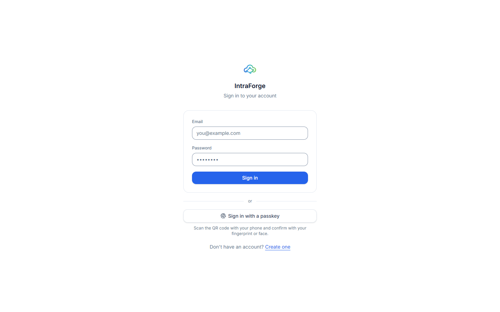
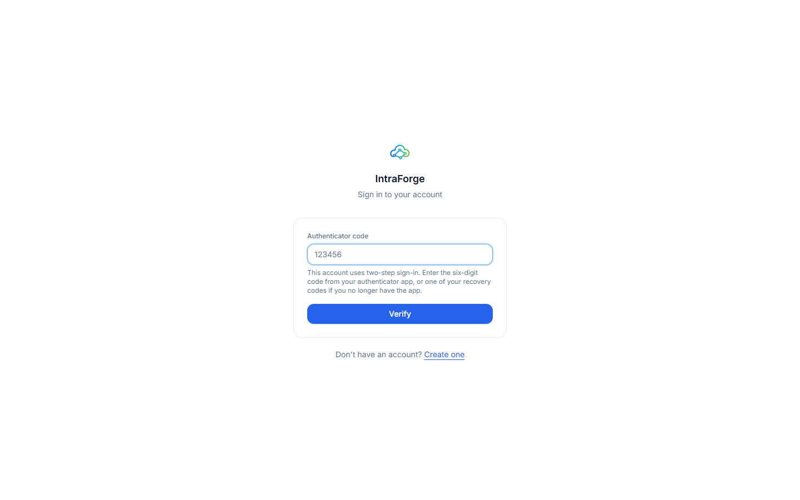
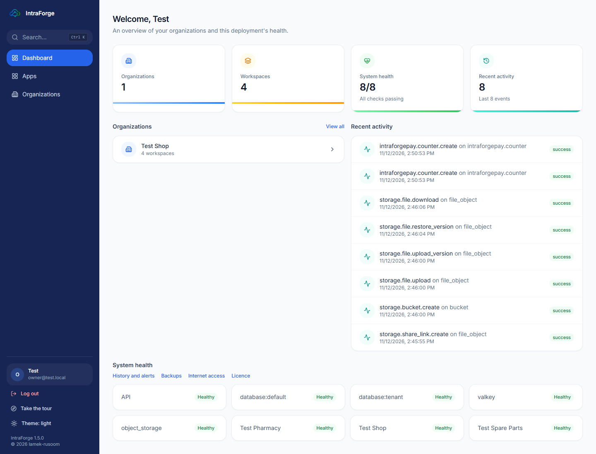
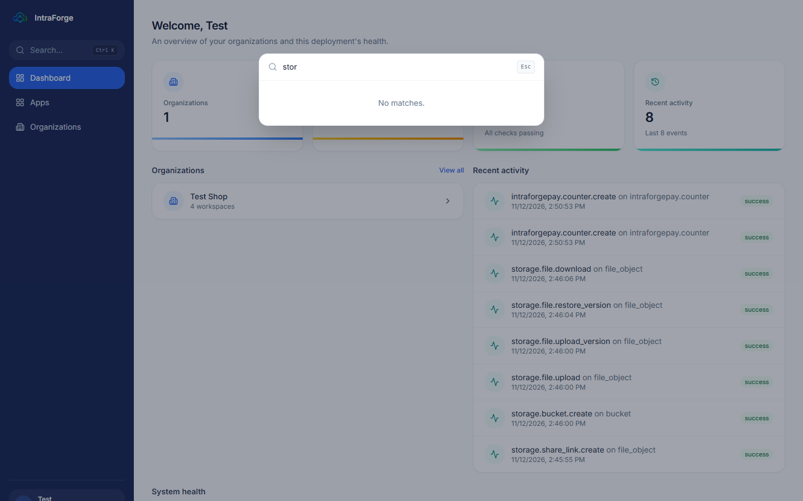
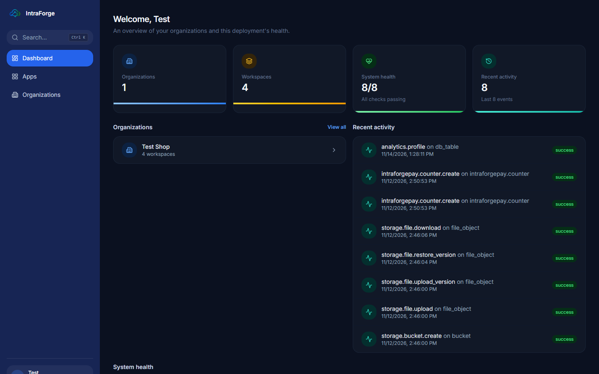
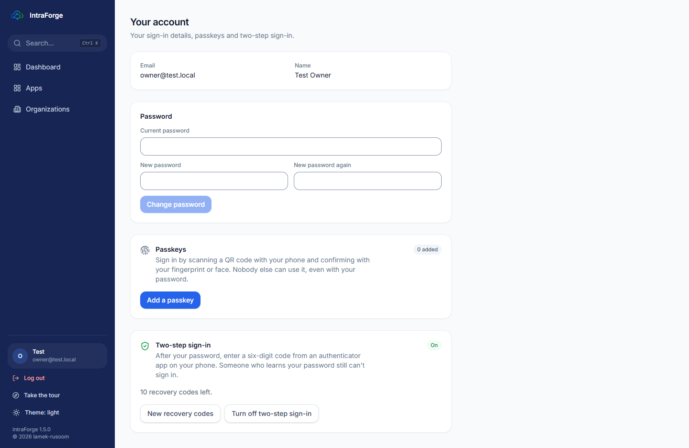
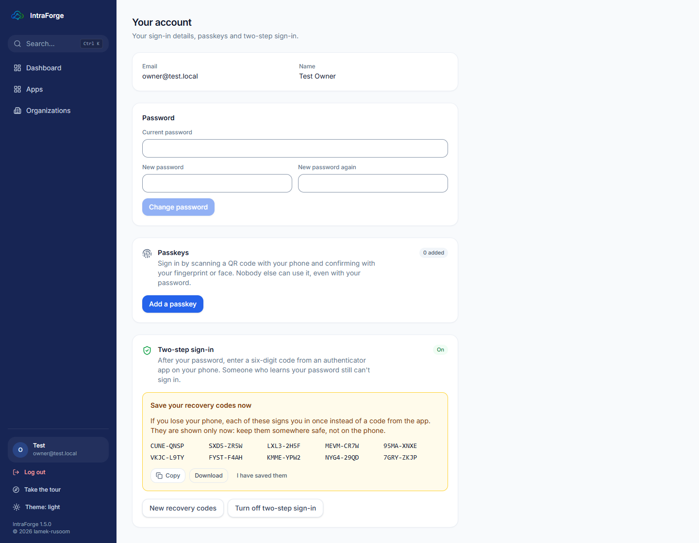

# Welcome to IntraForge

IntraForge is your shop's own business system. It runs on one PC in the shop, keeps all data on that PC (never on the
internet unless the owner switches that on), and gives everyone a browser page to work in: the shop's files, its
databases, and the applications the shop uses every day — **Spare Parts** (or **Pharmacy**) for stock and sales, the
**Movie Shop** for selling films and music onto customers' USB drives, and **IntraForge Pay** for the shop's wallet
payments.

## How to use this guide

Each lesson is for one kind of person in the shop. Read the lesson for your job, follow the steps on a real IntraForge
(a test copy is ideal for practice), then do the exercise at the end.

| Lesson | Who it is for |
|---|---|
| 1. Signing in and finding your way | Everyone |
| 2. The owner: the Control Center, the licence, people | The shop owner or administrator |
| 3. Files and data | Anyone who keeps files or tables |
| 4. Spare Parts and Pharmacy | Cashiers, stock keepers, managers |
| 5. The Movie Shop and its customer portal | Counter staff and customers |
| 6. IntraForge Pay | Cashiers and supervisors |
| 7. Keeping the shop safe | The owner or administrator |
| 8. Practice exercises and help | Everyone |

> **Words used here.** *Organization* = your company in IntraForge. *Workspace* and *project* = folders that group
> your work. *Bucket* = a place for files. *App* = an application installed in IntraForge (Spare Parts, Pay ...).

# Lesson 1 — Signing in and finding your way

## Signing in

Open IntraForge in the browser. On the shop PC the address is **https://localhost:8443**; on another PC in the shop it
is the address the owner gives you (for example **https://desktop-shop:8443**).

1. Type your **email** and **password**, then press **Sign in**.
2. If your account uses **two-step sign-in**, a second box asks for the **6-digit code** from the authenticator app on
   your phone. Type it and press **Verify**.

> Lost your phone? Each person with two-step sign-in has **recovery codes** (saved when two-step was switched on).
> Type one of them instead of the 6-digit code. Each code works once.

If the owner reset your password, IntraForge first asks you to **choose your own password**: type the temporary
password, then your new password twice. Nothing else opens until you do.

## The dashboard

After signing in you see the **Dashboard**: your organizations, the health of the system and the latest activity.

On the left is the **sidebar**: Dashboard, Apps, Organizations, and at the bottom your name, **Log out**, **Take the
tour** and **Theme**.

- **Search (Ctrl K):** press **Ctrl** and **K** together anywhere to find a page, a bucket, a database or an app by
  typing part of its name.

- **Theme:** the **Theme** button switches between *like this computer*, *light* and *dark*.

## Your account

Click your name at the bottom of the sidebar to open **Your account**. Here you can:

- **Change your password** (type the current one, then the new one twice).
- Add a **passkey** (sign in with your fingerprint or face on a phone).
- Switch **two-step sign-in** on or off, and make **new recovery codes**.

### Exercise 1

1. Sign in. 2. Press Ctrl K and open your organization by typing its name. 3. Switch the theme to dark and back.
4. Open Your account and look at your two-step sign-in status.
