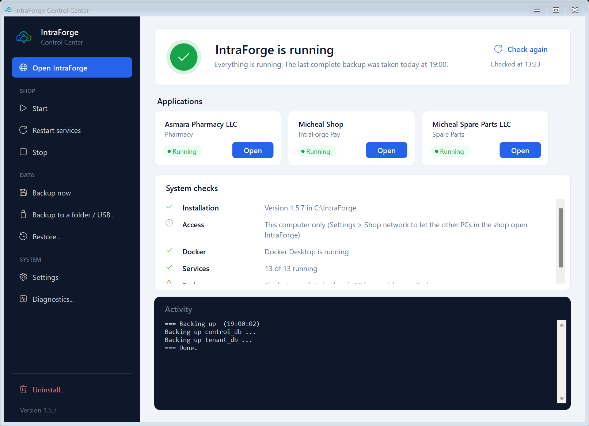
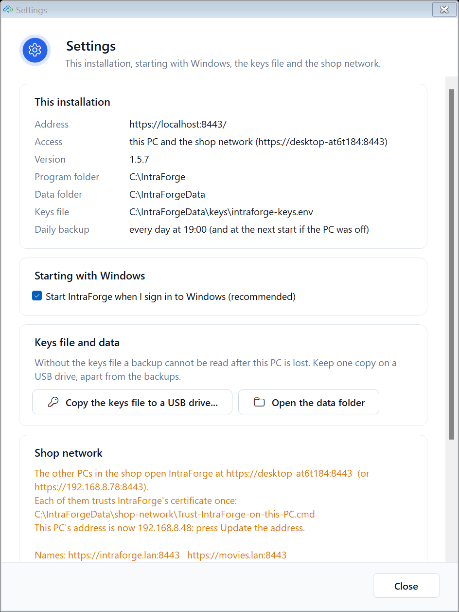
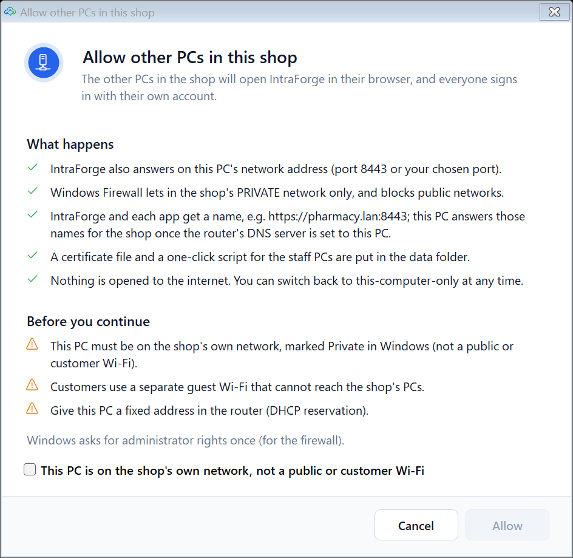
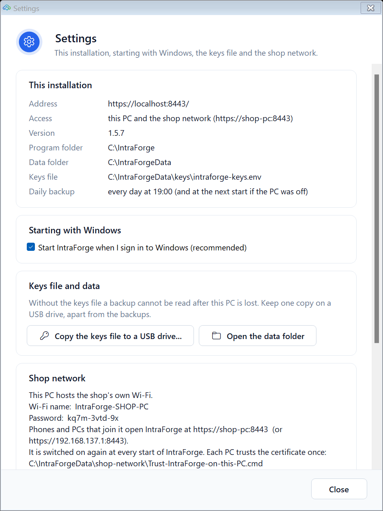
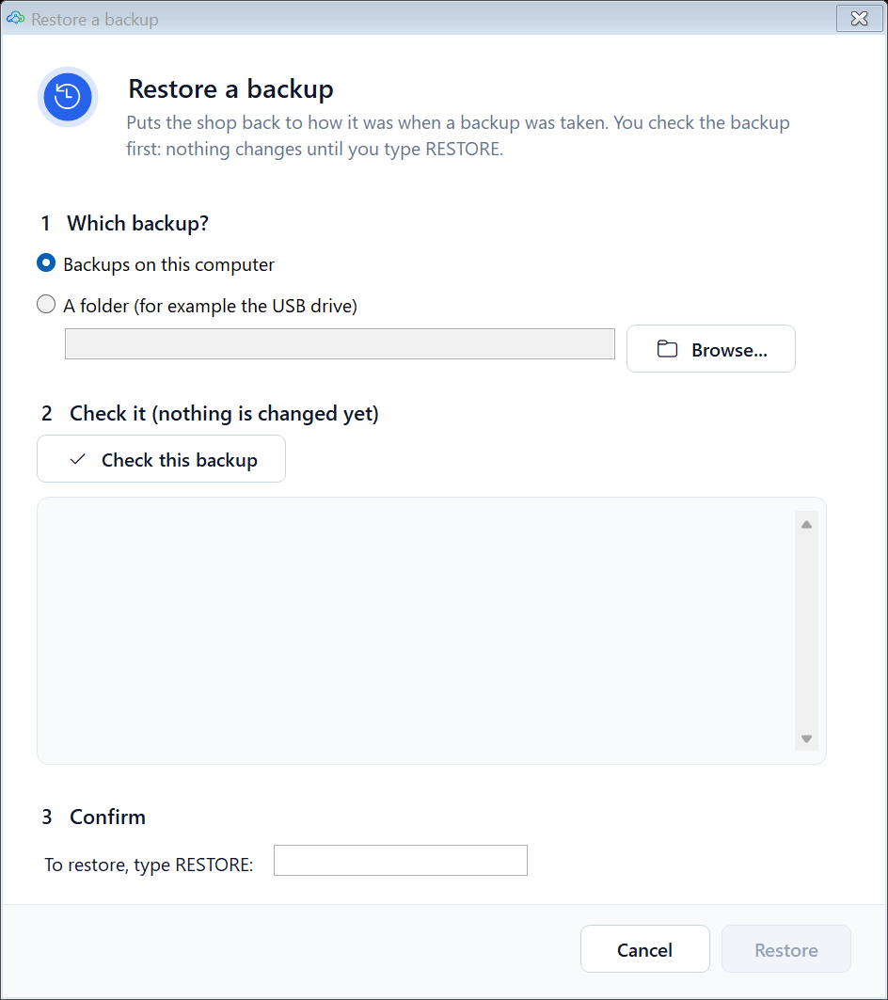
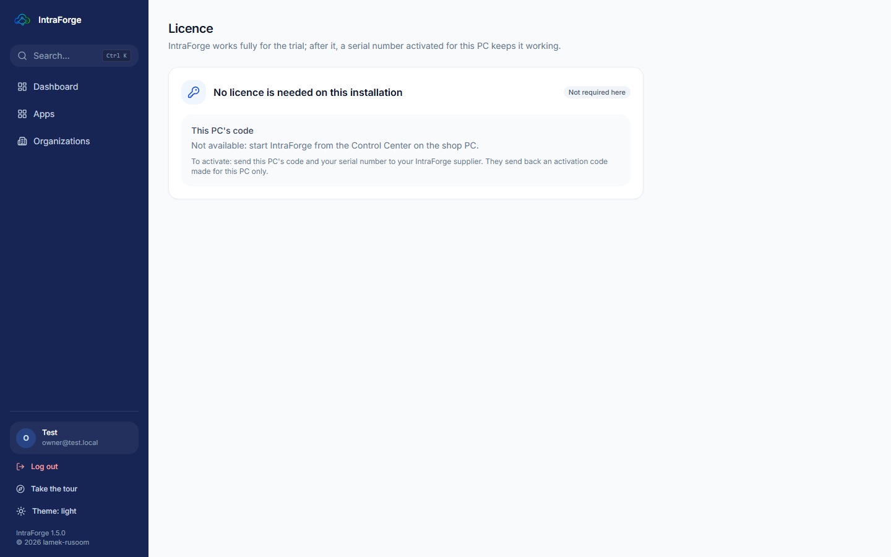
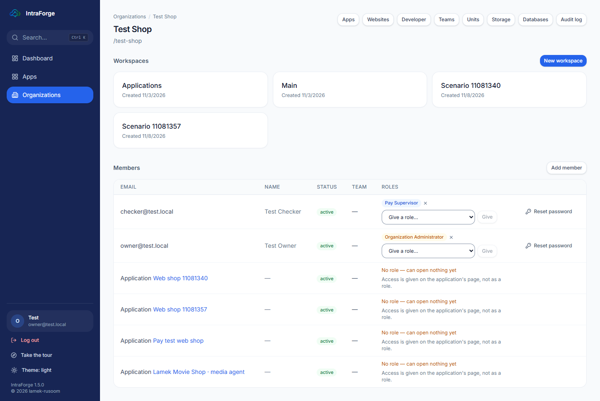
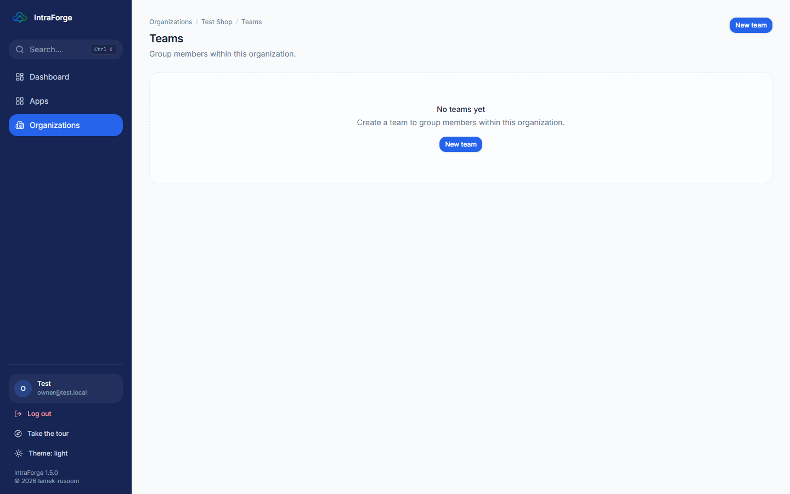
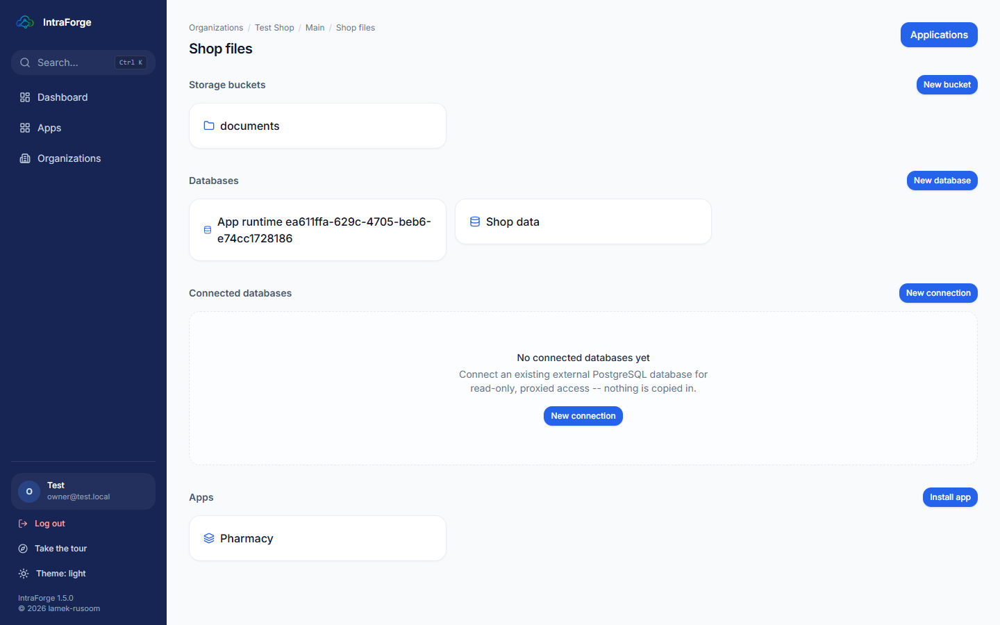

# Lesson 2 — The owner: the Control Center, the licence and people

## The Control Center (on the shop PC)

The **IntraForge Control Center** is the program on the shop PC (the **IntraForge** shortcut on the Desktop). It starts
and stops IntraForge, shows whether everything is healthy, takes backups and restores them, and lets the other PCs in
the shop in.

- **Start / Stop / Restart** IntraForge. **Open IntraForge** opens it in the browser.
- The checks show green when all is well; a yellow or red line says what to do.
- **Back up now** takes a complete backup (it also runs every night by itself).

### Settings and the shop network

**Settings** shows where IntraForge is installed, whether it starts with Windows, and the **shop network**.

To let the other PCs and phones in the shop use IntraForge:

1. In Windows, make sure the shop's Wi-Fi is a **Private** network (Settings > Network & internet > Wi-Fi > your
   network > Network profile type: Private). Never do this on a café or customer Wi-Fi.
2. In the Control Center: **Settings > Shop network > Allow other PCs in this shop...**, tick that this is the shop's
   own network and press **Allow**.

3. Each other PC runs **Trust-IntraForge-on-this-PC.cmd** once (from the folder `C:\IntraForgeData\shop-network`) and
   opens the address shown in Settings.

No router in the shop? **Create a shop Wi-Fi from this PC** makes the PC itself the shop's Wi-Fi.

> If the PC moves to another network, IntraForge still starts for the PC itself. Back on the shop Wi-Fi, press
> **Settings > Shop network > Update the address** so the other PCs can reach it again.

### Backups and restoring

IntraForge backs everything up every night and tests that each backup can be restored. To put a backup back (for
example after a mistake), use **Restore** in the Control Center. Restoring replaces today's data with the backup's, so
it is done only here, never from a browser.

## The licence

IntraForge works fully for **30 days** after it is first started. After that it needs a **serial number**; without
one it becomes **read-only** (everyone can still sign in, see and export everything, and backups keep running, but
nothing can be changed).

To activate: open **Licence** (the link in the banner at the top, or `/license`), send **this PC's code** (PC-....) and
your **serial number** to your IntraForge supplier, and type the **activation code** they send back.

## Your organization and its people

**Organizations** lists your company (or companies). Open it to see its workspaces, members, roles and links to every
page that belongs to it.

### Adding a staff member

1. The staff member opens IntraForge on their PC, chooses **Create one** on the sign-in page and makes an account.
2. You: **Organizations > your shop > Add member**, type their email.
3. Give them a **role** in the member's row (for example *Cashier* for selling, *Stock keeper* for receiving). A
   person can do only what their role allows; the server checks every action.

### A staff member forgot their password

In the member list press **Reset password**. IntraForge shows a **temporary password** once: give it to the person.
They are signed out everywhere and must choose their own password when they sign in with it. (You can reset someone
only if you manage every organization they belong to.)

### Teams and units

**Teams** group members (for example "Front counter"); **Units** describe branches and departments. Both are on the
organization page.

## Workspaces and projects

A **workspace** groups **projects**; a project holds the shop's **buckets** (files), **databases** and installed
**apps**.

### Exercise 2

1. In a test copy, add a second member and give them a role. 2. Sign in as that person in another browser and see what
they can and cannot open. 3. Reset their password and sign in with the temporary one.
