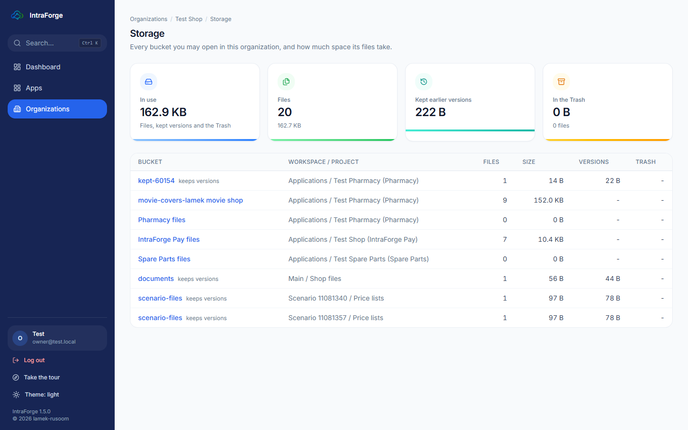
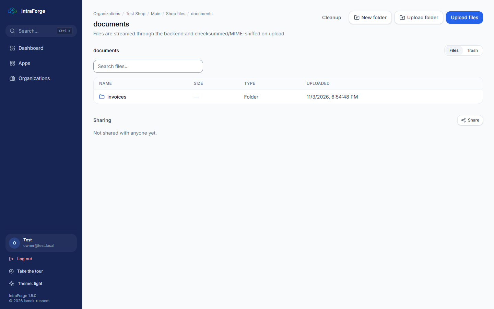
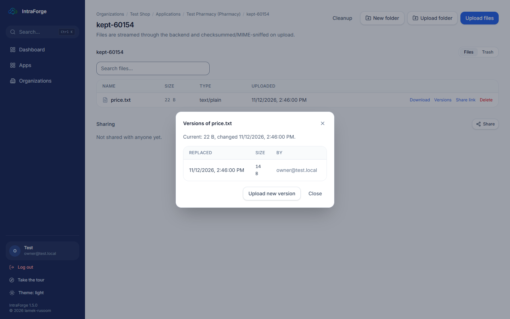
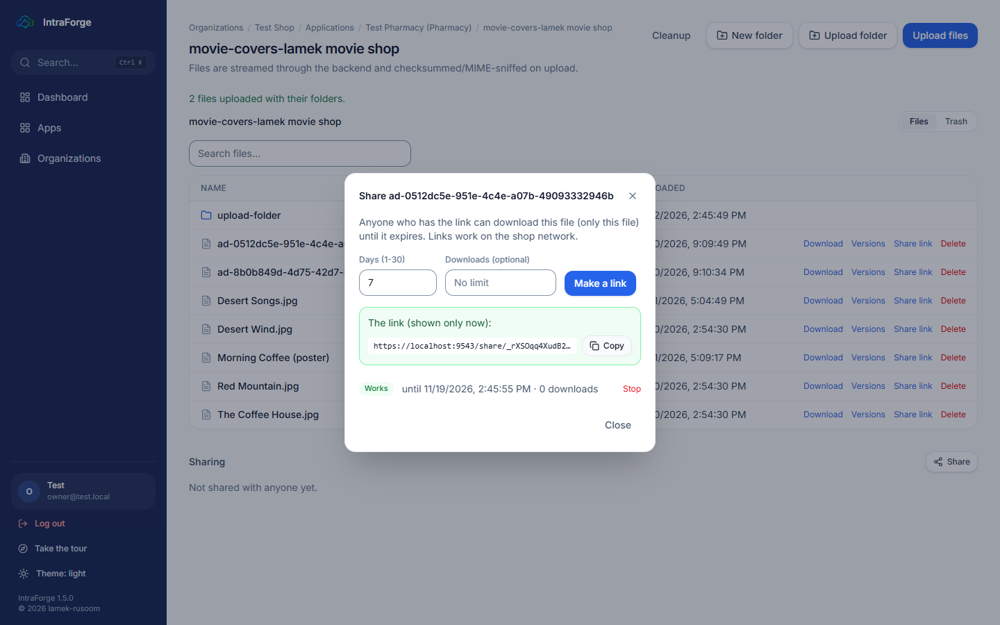
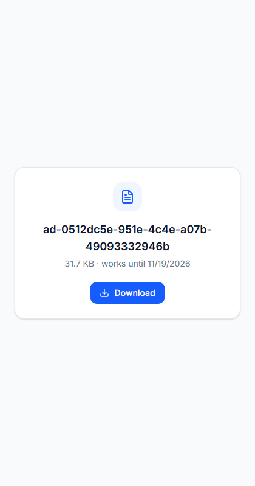
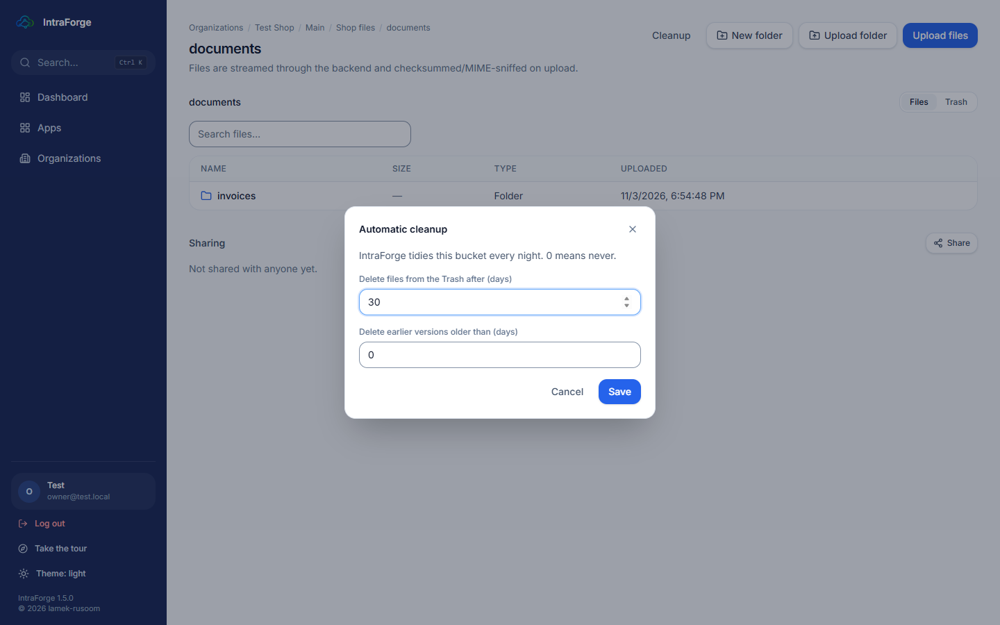
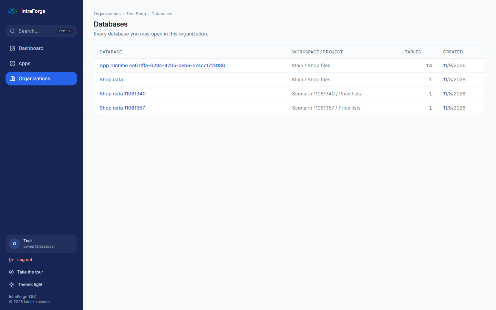
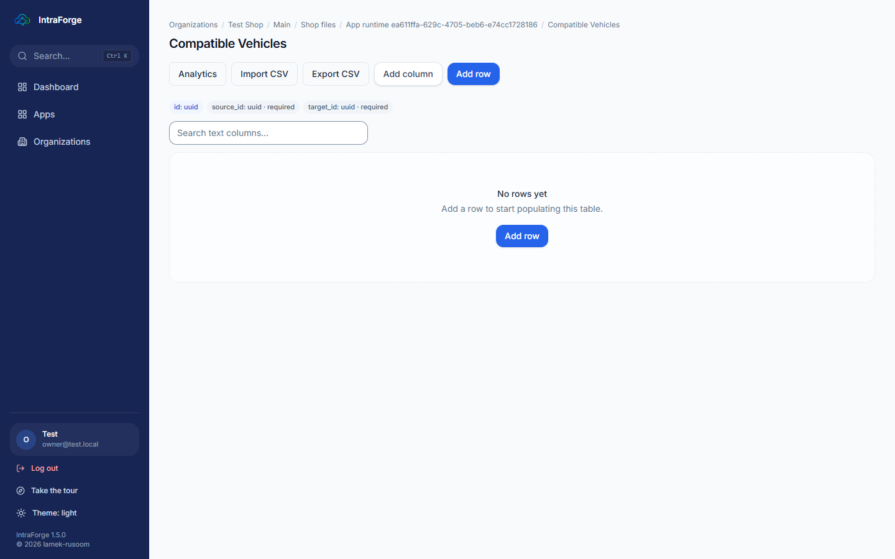
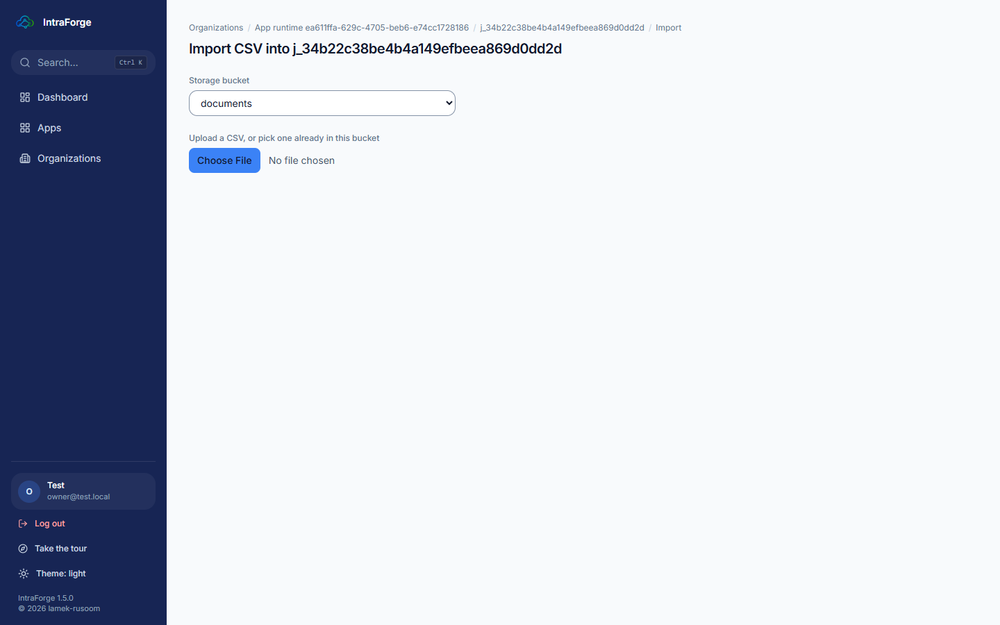
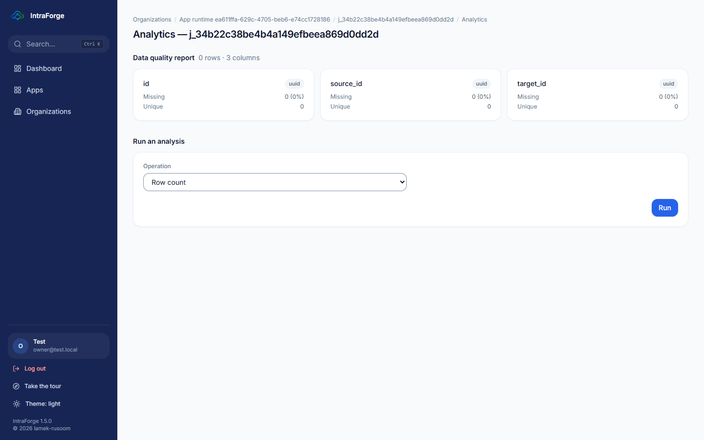

# Lesson 3 — Files and data

## Storage: all your buckets

**Organization > Storage** lists every bucket you may open, with its files, size, kept versions and the Trash, and the
totals for the organization.

## A bucket

Open a bucket to see its folders and files.

- **Upload files** — choose one or more files from the computer.
- **Upload folder** — choose a whole folder; its sub-folders are made in the bucket and each file goes into its own.
- **New folder**, and the search box to find a file by name.
- Each file has **Download**, **Versions**, **Share link** and **Delete**.
- **Delete** moves a file to the **Trash** (top right: Files / Trash), where it can be **restored**.

### Earlier versions of a file

A bucket that **keeps versions** keeps each file's earlier contents when you upload a new version. **Versions** lists
them: **Download** an earlier one, or **Restore** it (the current content is kept, so you can go back again).

### Share links

**Share link** makes a link anyone can use to download that one file, for 1 to 30 days, optionally limited to a number
of downloads. The link is shown once; **Stop** ends it early.

### Automatic cleanup

**Cleanup** sets how many days files stay in the Trash (30 unless changed) and how long earlier versions are kept.
IntraForge tidies every night.

## Databases and tables

**Organization > Databases** lists every database you may open. A database has **tables**; a table is like a
spreadsheet whose columns have types (text, number, date...).

- **Import a CSV file** into a table: upload or pick a stored CSV, check the detected columns, match them to the
  table's columns, and watch the import finish.

- **Analytics** profiles each column (empty values, ranges) and runs statistics (averages, correlation, trends).

## Connected databases (PostgreSQL, MySQL, SQL Server)

A project can **connect** to another database the shop already has (for example an old point-of-sale system) and read
its tables live, without copying them: **Project > Connect a database**, choose the **database type**, then the
address, database name, a user and password. Use a database user that may only **read**.

### Exercise 3

1. Upload a folder with two files in it. 2. Upload a new version of one file and restore the old one. 3. Make a share
link for one day and open it in a private browser window. 4. Delete a file and restore it from the Trash.
