# Lesson 4 — Spare Parts and Pharmacy

**Spare Parts** is the shop's stock and sales application; **Pharmacy** is the same application set up for medicines
(generic name, strength, prescription flag, expiry). Open it from **Apps > Open** — you are signed in with your
IntraForge account, no second password.

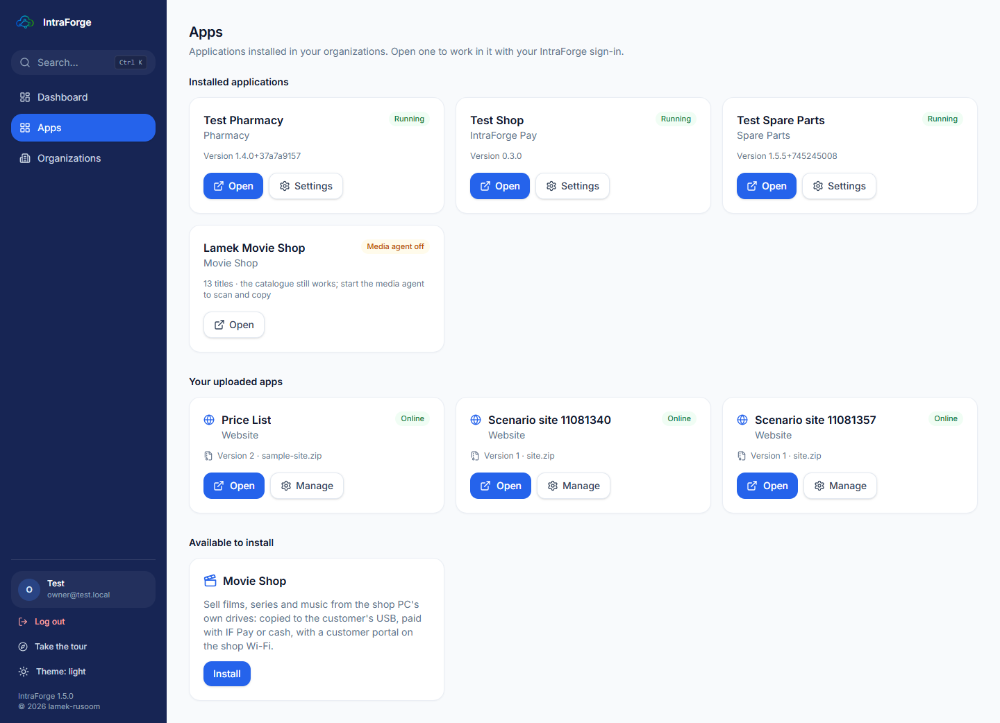

## The dashboard

The **Business overview** shows products, low stock, stock value, sales this month, open enquiries, quotations, orders
and unpaid invoices.

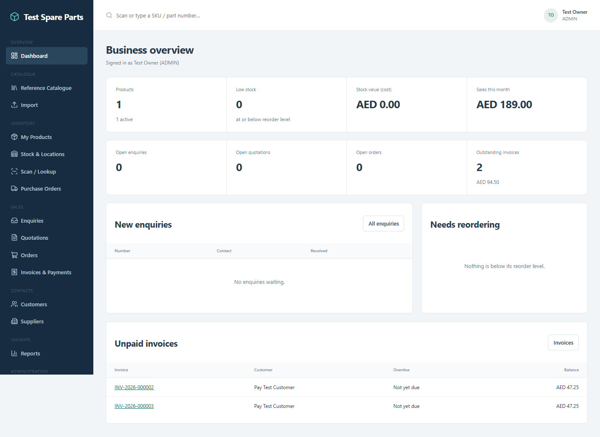

The menu on the left: **Reference Catalogue**, **Import**, **My Products**, **Stock & Locations**, **Scan / Lookup**,
**Purchase Orders**, **Enquiries**, **Quotations**, **Orders**, **Invoices & Payments**, **Customers**, **Suppliers**,
**Reports** and **Administration**.

## Products

**My Products** lists what the shop sells: name, part number (SKU), stock and price.

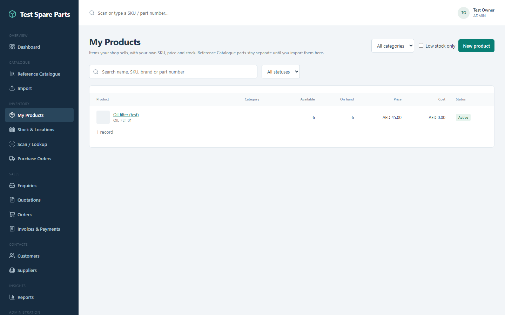

Open a product to see its stock, photos, details and history.

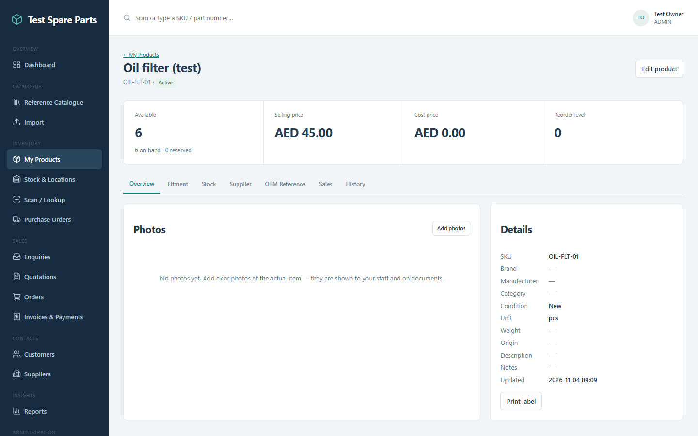

### Printing a label

On a product press **Print label**. Choose the **paper** (label printer 50 × 30 mm, or an A4 sheet of 24 labels),
**barcode or QR code**, the number of **copies** and whether to show the **price**. The label shows the shop's name,
the product and its part number. **Print** opens a page sized for the paper; **Download picture** saves PNG files.

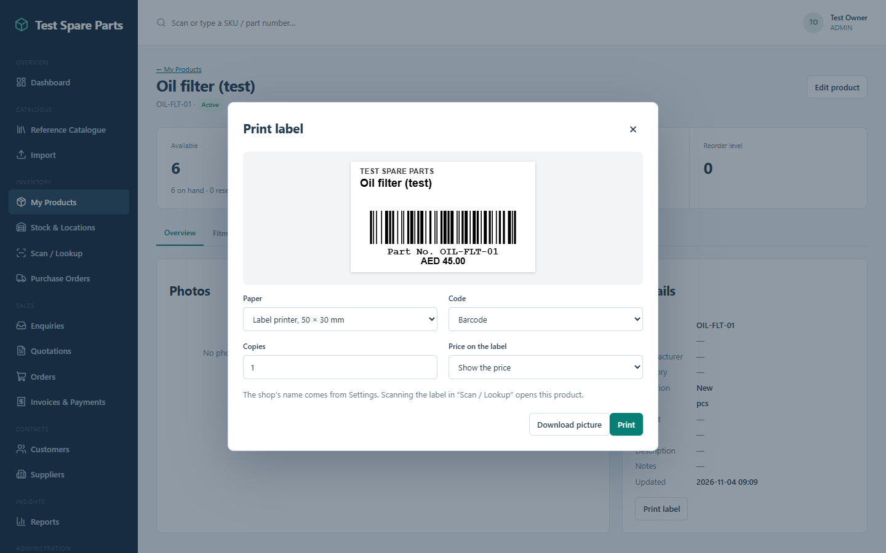

> The shop's name on the label comes from **Administration > Settings**.

## Selling

1. Open **Sell** (or scan a product's label in **Scan / Lookup**).
2. Add the products and quantities; choose the customer if they have an account.
3. Take the payment (cash, or an **IntraForge Pay** QR code the customer scans with the wallet app).
4. The invoice is created and the stock goes down — once, even if two people sell at the same time.

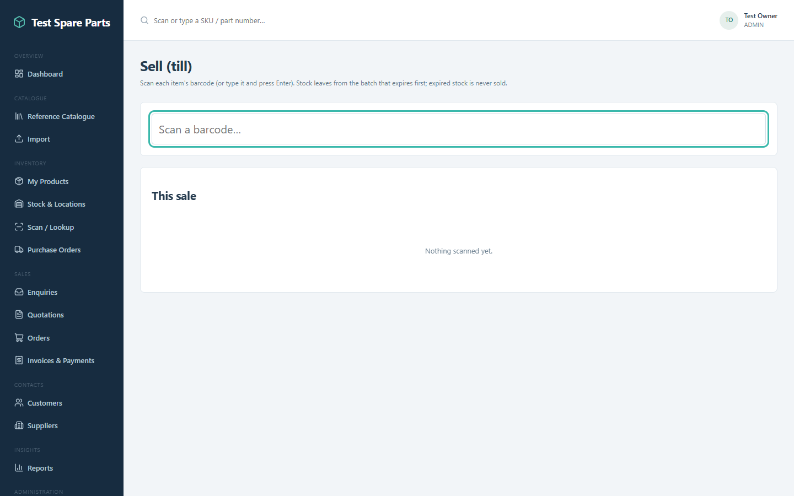

> **Careful:** the right to sell is not the right to receive or adjust stock. Each is a separate permission the owner
> gives; if a button is missing for you, ask the owner for that role.

## Stock, receiving and purchasing

- **Stock & Locations** shows how many of each product are on hand and where.

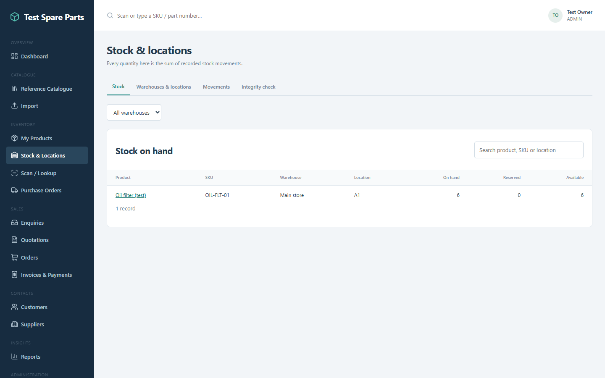

- **Purchase Orders**: order from a supplier, then **receive** the goods — the stock goes up.

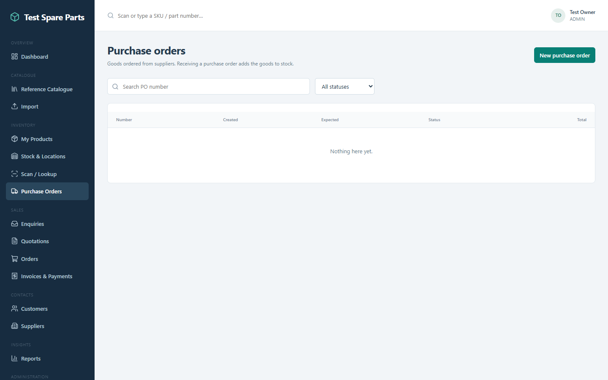

## Invoices, customers, reports

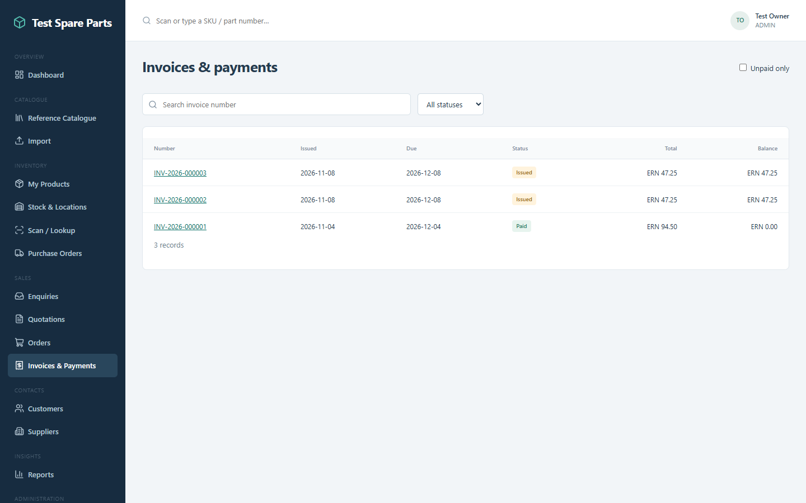

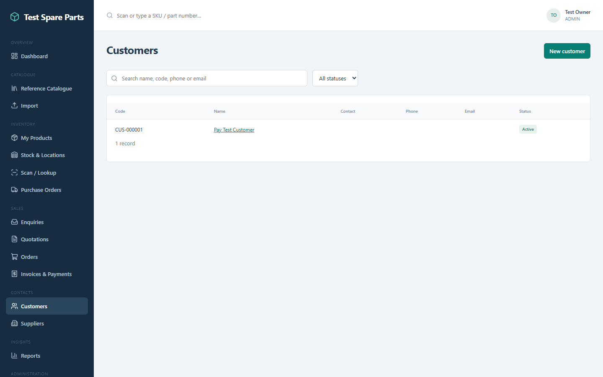

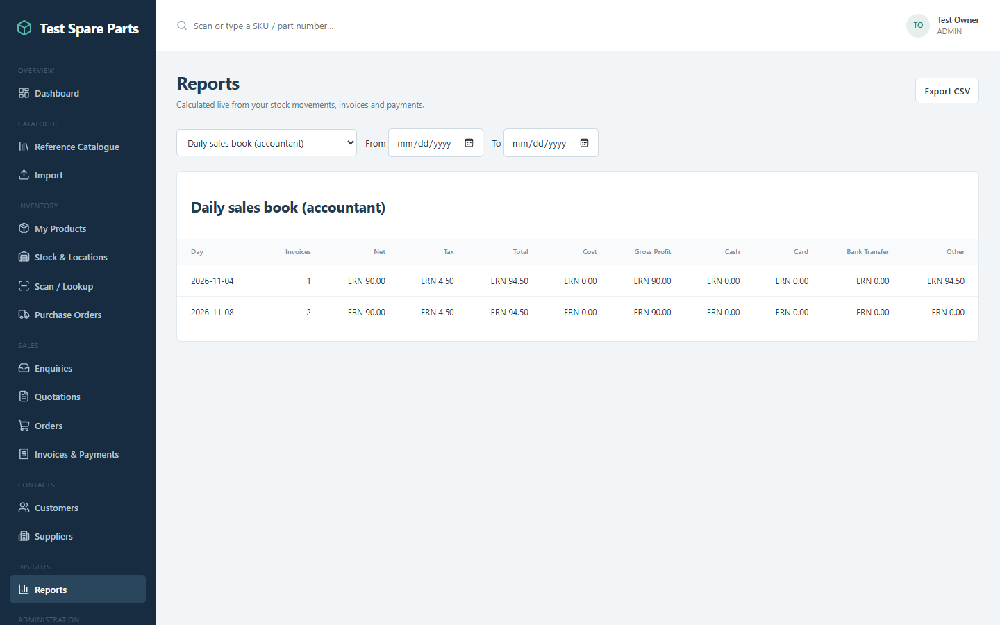

## Scan, catalogue and administration

- **Scan / Lookup**: scan a barcode or QR label (or type a part number) to open the product at once.
- **Reference Catalogue**: look up parts in an imported catalogue and add them to your products.
- **Administration**: the shop's settings (name, currency, tax) and its users' roles in this app.

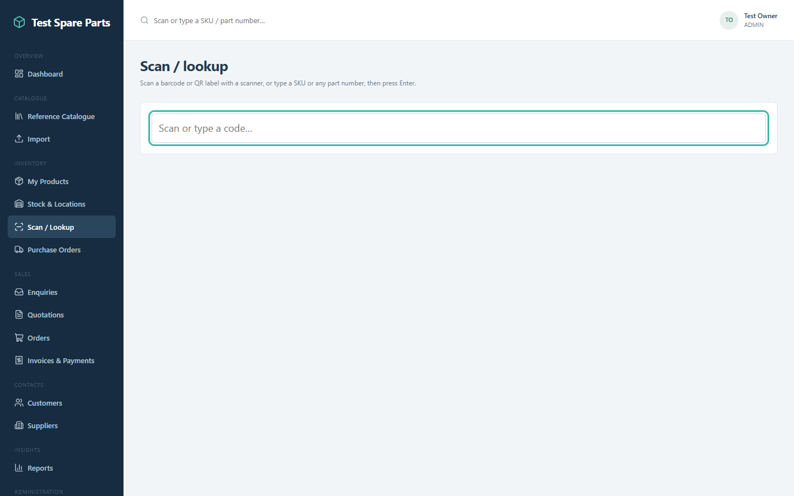

## Pharmacy

The Pharmacy works the same way. A medicine has a generic name, strength and form, a **prescription** flag (its label
shows **Rx**), a shelf location and expiry dates; **Expiry** lists what expires soon.

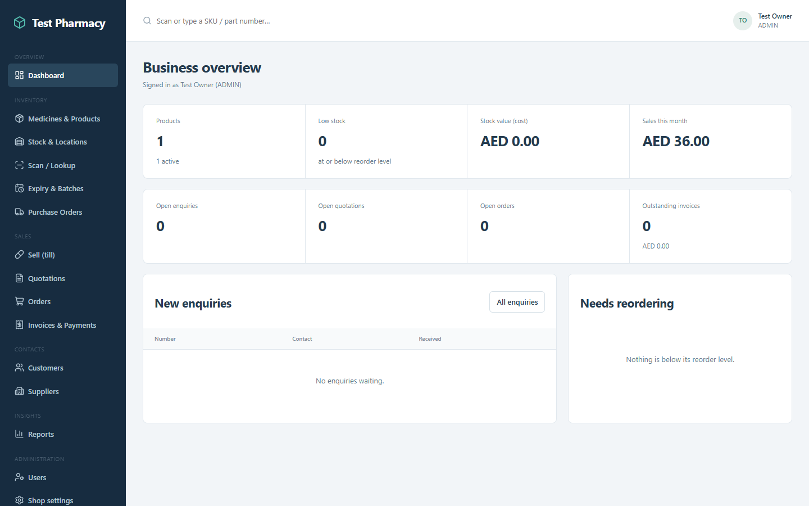

### Exercise 4

1. Add a product with a part number and a price. 2. Print its label on the A4 sheet. 3. Receive 10 through a purchase
order. 4. Sell 2 to a customer and find the invoice. 5. Check the stock shows 8.
