# Lesson 5 — The Movie Shop and its customer portal

The **Movie Shop** turns the films, series and music on the shop PC's own drives into a catalogue, sells them for IF
Pay or cash, and copies them onto the customer's USB drive. Customers can also browse and order from their own phones
on the shop's Wi-Fi.

## Setting up (the owner, once)

1. **Apps > Available to install > Movie Shop > Install**; the shop appears under Installed applications.
2. On the shop PC, run the **media agent** once (**Add storage** shows the steps and a pairing key). The agent reads the
   drives and copies the files; IntraForge never moves your files.
3. **Add storage**: choose the folders that hold the films (for example `D:\Movies`). Every folder inside becomes a
   category; every video, song or album becomes a title, with its cover when a picture sits beside it.

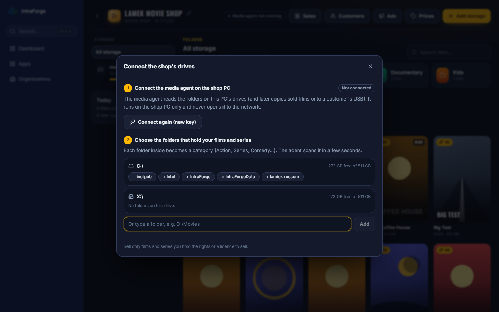

## The catalogue

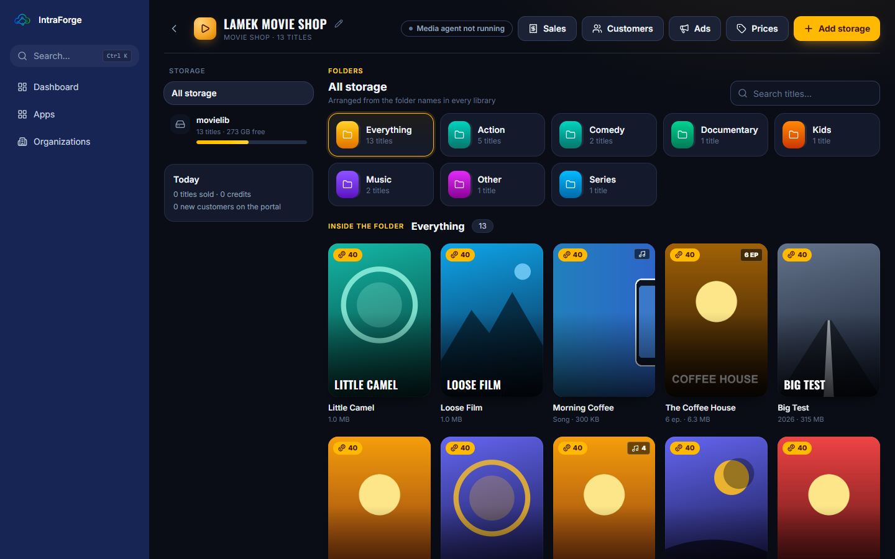

- **Storage** on the left (each drive, its free space) and the **Today** card (titles sold, credits, new customers).
- **Folders** across the top; click one to see its titles below. **Search titles** finds a title by name.
- Hover a poster: **Edit** (name, year, category, own price, hide, **Change poster**) and **Add** to the cart.

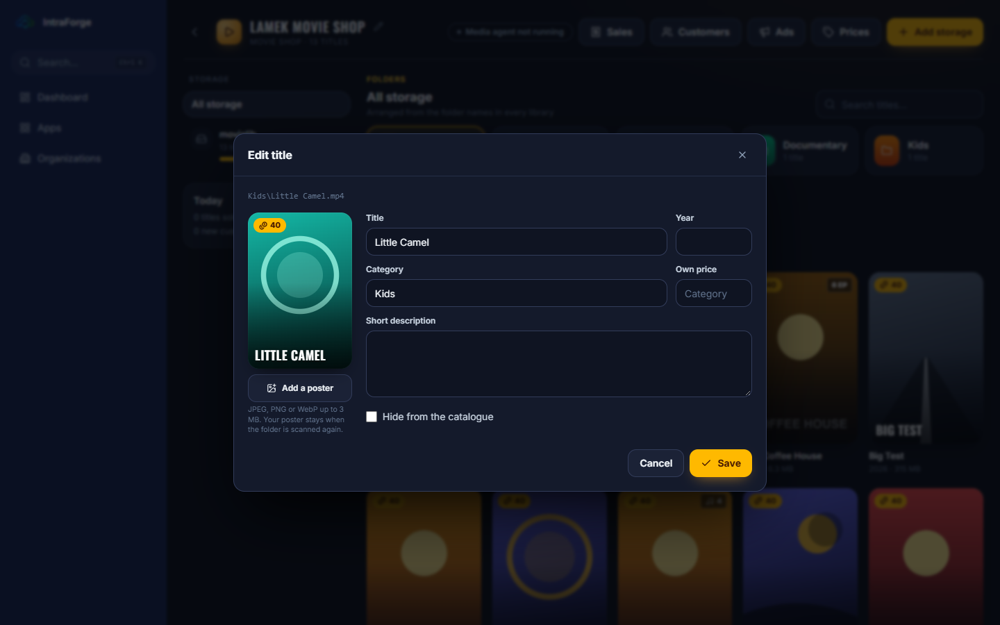

- **Prices** sets one price for everything and one per category; a title can have its own.

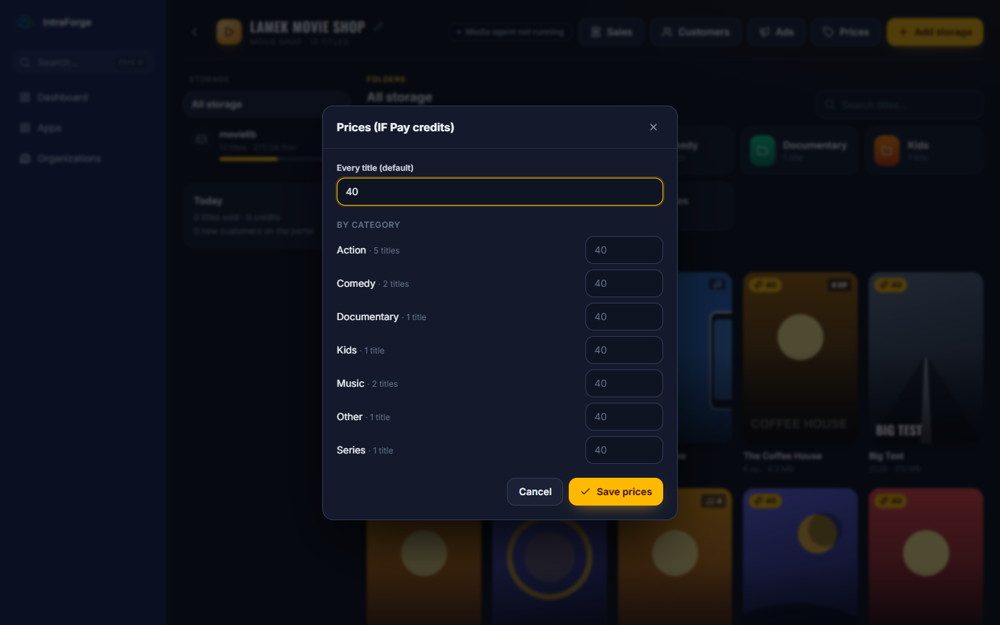

## Selling at the counter

1. Plug the customer's USB drive into the shop PC.
2. **Add** the titles to the cart.
3. Choose the **customer's drive**. If the customer has a portal account, type their **phone number** under **Portal
   customer**: their free titles and (if ticked) their points apply.
4. Choose **IF Pay** (the customer scans the QR code with the wallet) or **Cash**, and press **Charge**.
5. The media agent copies the titles into a folder named after the shop; the sale shows each title's progress.

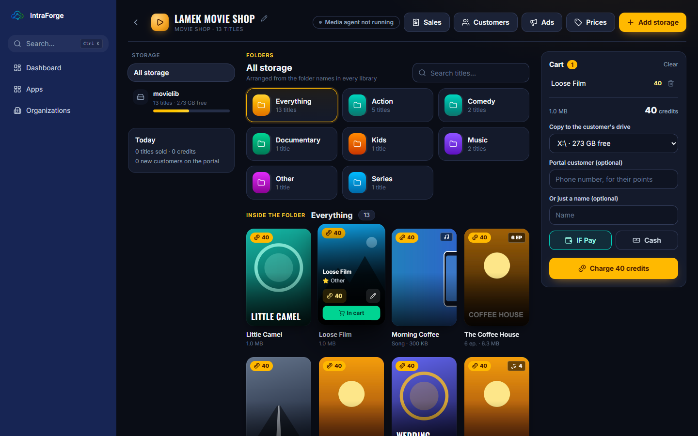

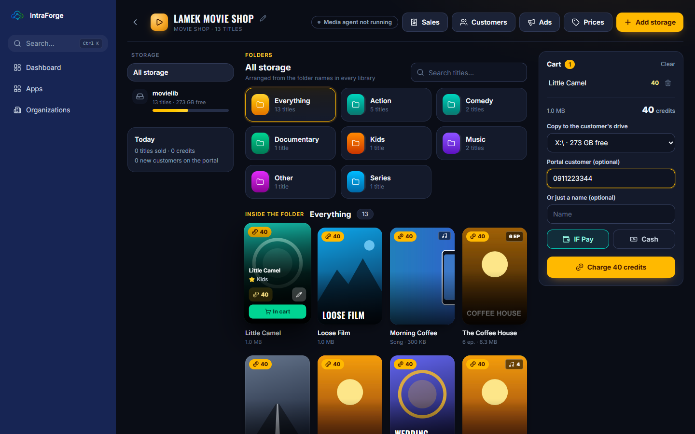

**Sales** lists every sale; open one to see its payment and copying, cancel it, or retry a failed copy.

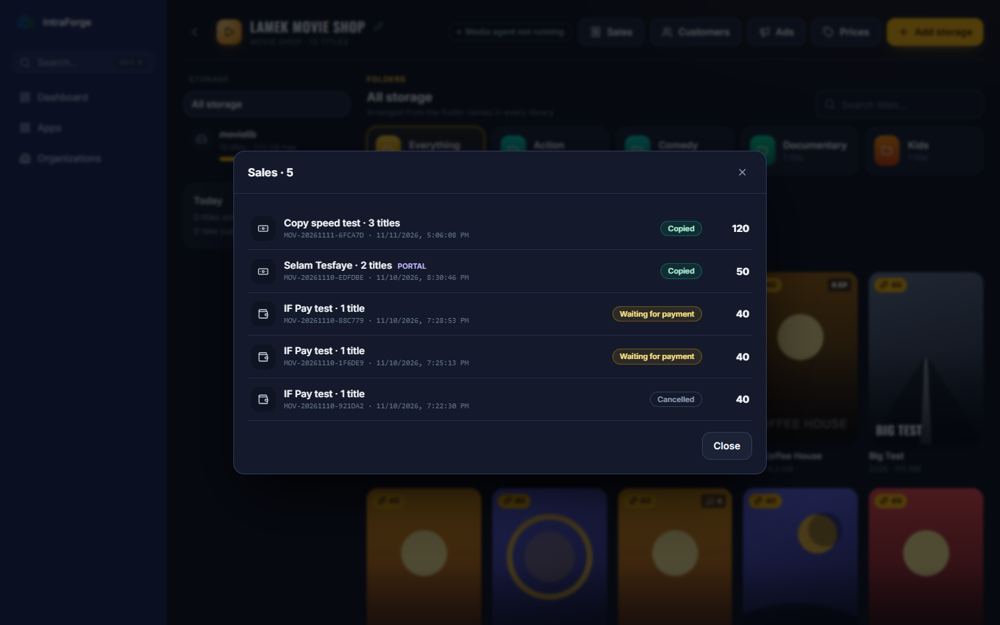

## Customers and rewards

**Customers** lists the people who signed up on the portal. **Approve** opens their IF Pay wallet; you can **Reject**,
**Block**, **Edit** them, give a **Password code** when they forgot their password, or give their wallet a new one-time
password. Rewards (welcome points, referral points, birthday points, every Nth title free) are set in the portal
settings.

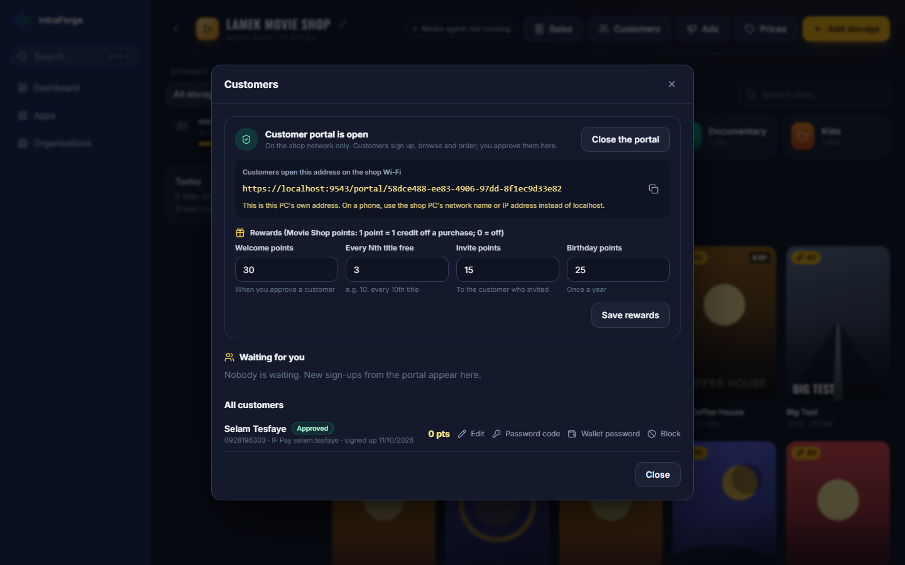

## Ads

**Ads** shows pictures or titles on the customer portal (for example new arrivals).

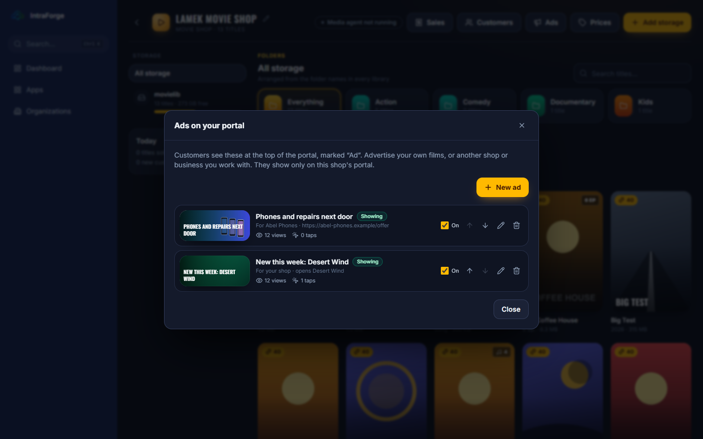

## The customer portal (on the customer's phone)

On the shop Wi-Fi, customers open **https://movies.lan:8443** (or the portal address the owner shows). They sign up
with a name, phone number and password and wait for the shop's approval; then they browse, order titles and pick them
up at the counter, and see their points and wallet.

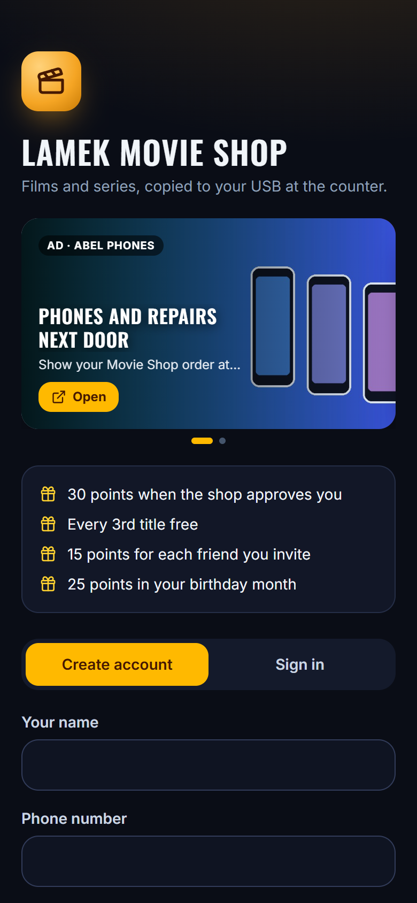

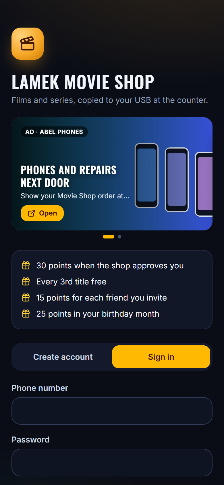

> A customer who forgot their password presses **Forgot password?**, then asks at the counter for a **one-time code**
> (Customers > Password code) and enters it under **I have a code** with a new password.

### Exercise 5

1. Sign up on the portal from a phone. 2. Approve the customer. 3. Order two titles from the phone. 4. Charge the order
at the counter with cash and watch it copy. 5. Find the sale in Sales and the customer's points on the phone.
