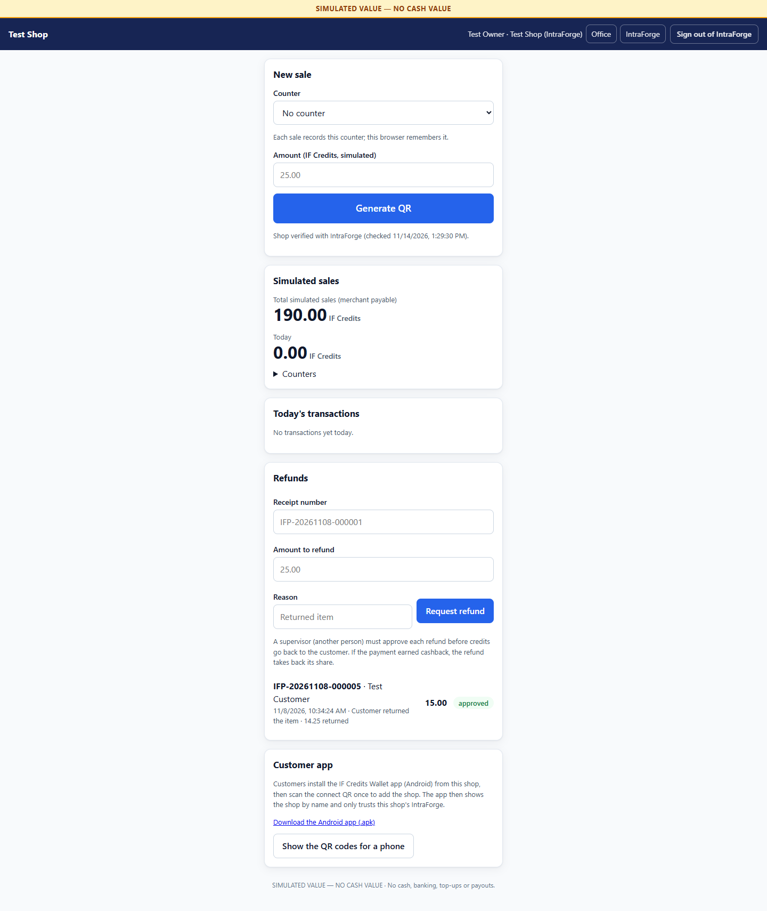
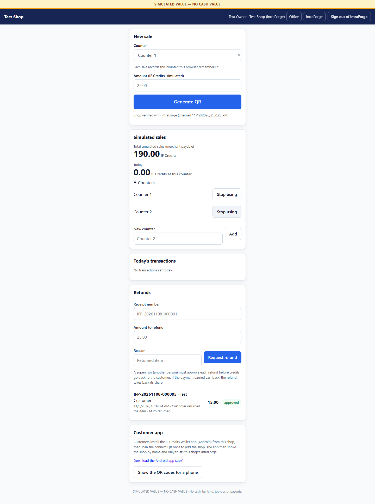
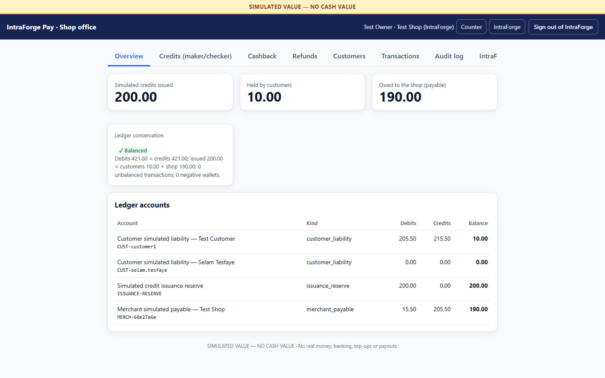
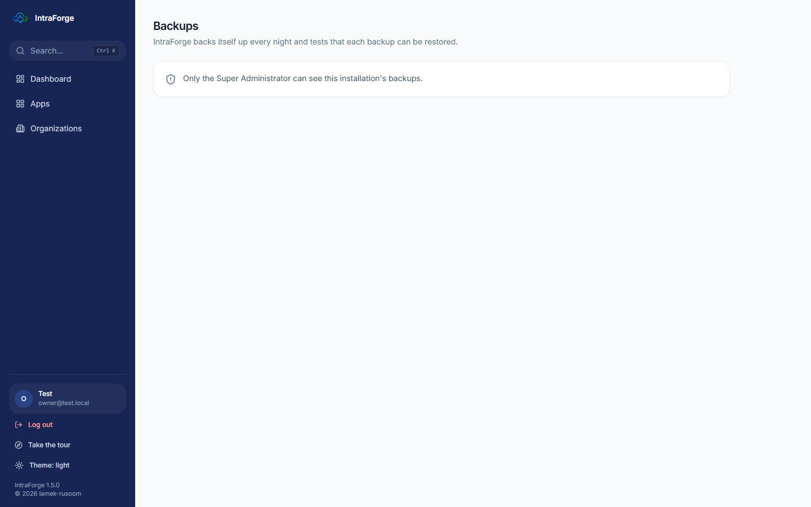
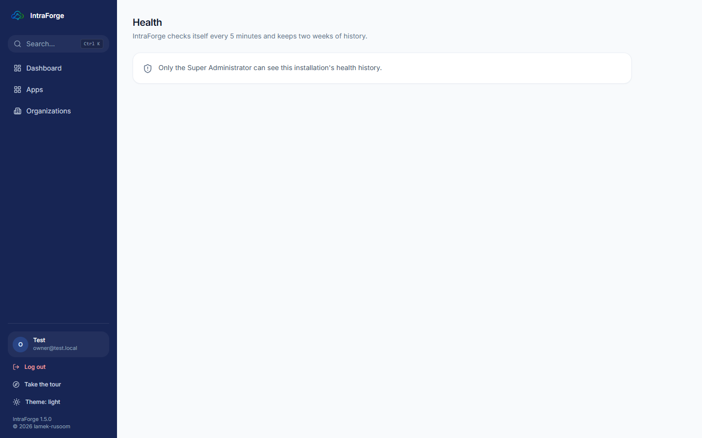
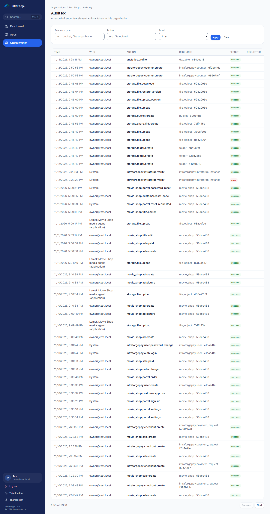
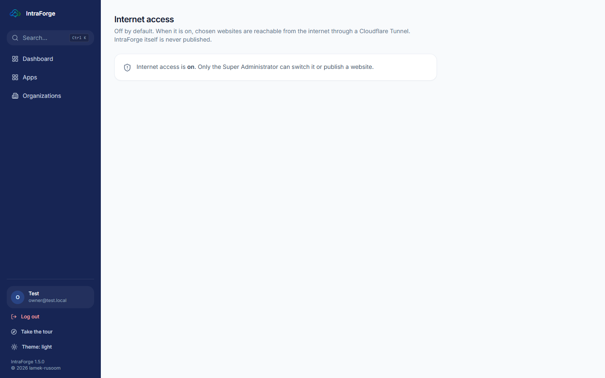

# Lesson 6 — IntraForge Pay

**IntraForge Pay** is the shop's wallet system. Customers hold **IF Credits** in a wallet (the **IF Credits Wallet**
Android app, or the wallet web page) and pay by scanning a QR code. In this pilot the credits are **simulated: no real
money**. Staff open Pay from **Apps > Open** with their IntraForge account; what they can do depends on their Pay role
(**Pay Cashier**, **Pay Supervisor**, **Pay Manager**).

## Taking a payment (cashier)

1. Choose your **Counter** once (the browser remembers it).
2. Type the **amount** and press **Generate QR**.
3. The customer scans the QR code with the wallet app and confirms the amount.
4. The status turns **paid** and the receipt appears under **Today's transactions**.

## Counters (Pay Manager)

**Simulated sales > Counters**: add a counter (**New counter > Add**) or stop using one. The **Today** figure shows
your counter's total; the list shows every counter's total and the shop's, in the shop's own time zone.

## Refunds (cashier asks, supervisor approves)

In **Refunds**, type the **receipt number**, the **amount** and the **reason** and press **Request refund**. Another
person, a supervisor, must approve it before the credits go back.

## The office (managers and supervisors)

The **Office** page (top right) is for customer wallets, credit allocations (a manager asks, a supervisor approves) and
the audit log.

# Lesson 7 — Keeping the shop safe

## Backups

**Dashboard > System health > Backups** (the Super Administrator) shows the last good backup of each kind and whether
its restore test passed. **Back up now** starts one. Restoring is done in the Control Center.

## Health and alerts

**Dashboard > System health > History and alerts** shows every check every 5 minutes for two weeks. An alert opens when
something keeps failing (a database, the job queue, file storage, an old backup, a nearly full disk, or the background
jobs stopped) and closes by itself when it is fixed. Open alerts also show on the dashboard.

## The audit log

**Organization > Audit log** lists every important action — who did it, when, and whether it was allowed. Filter by
action, resource or result.

## Internet access

IntraForge is **not** on the internet. Only the Super Administrator can switch **Internet access** on, to publish a
chosen website through a Cloudflare Tunnel; IntraForge itself is never published.

## Good habits

- Each person signs in with **their own** account — never share a password.
- Switch on **two-step sign-in** for the owner and managers, and keep the recovery codes on paper.
- Give people the **smallest role** that lets them do their job.
- Check the **Health** page and the backups once a week.
