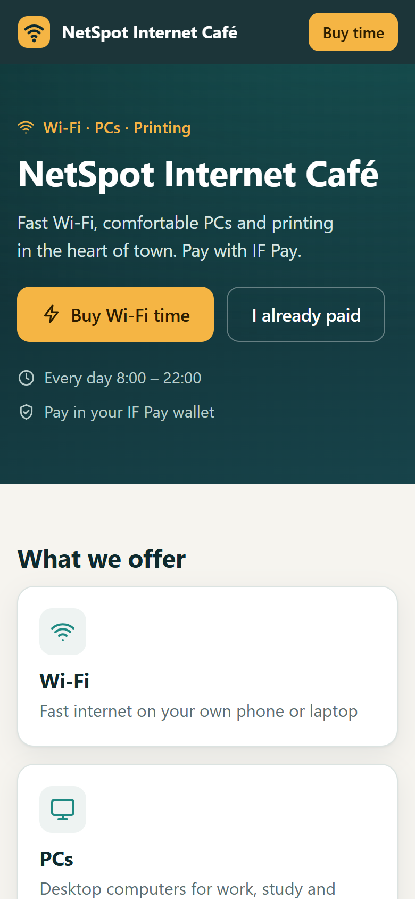
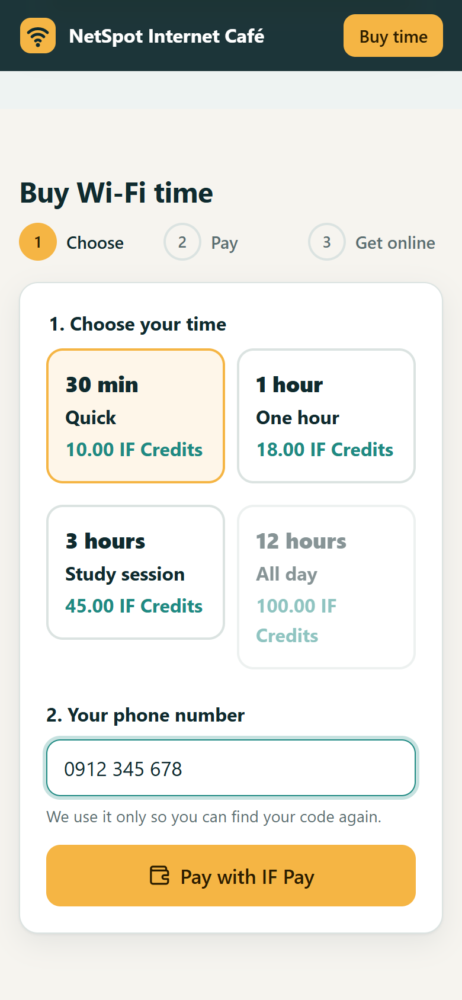
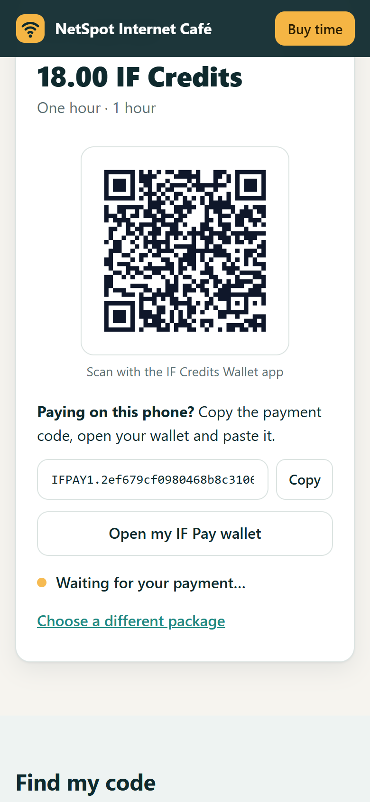
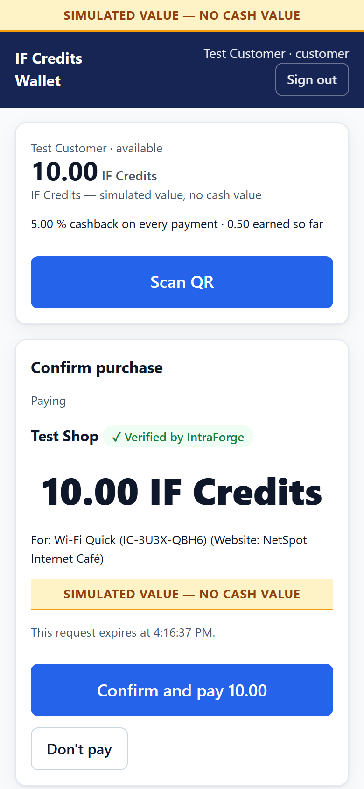
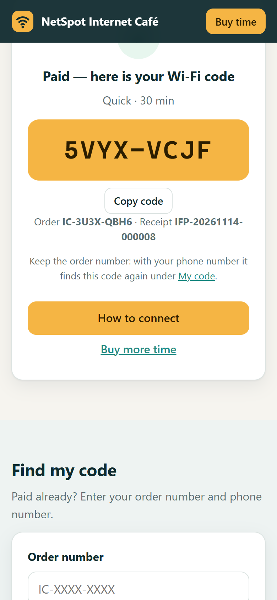
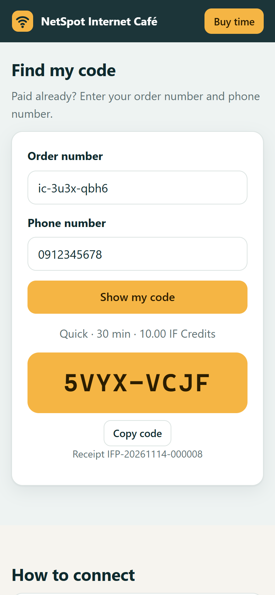
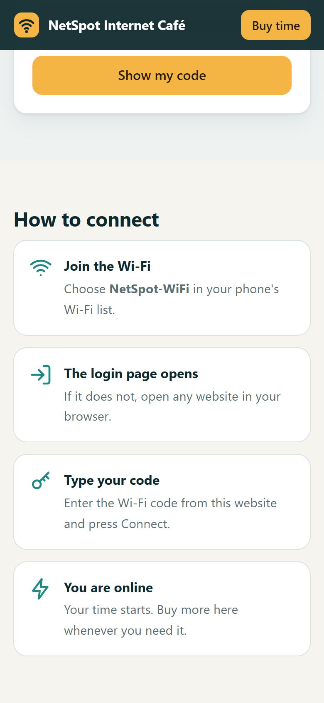
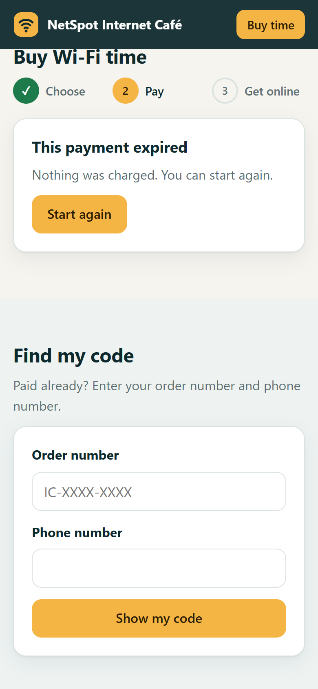

# Lesson 8 — The internet café website

The **internet café website** sells Wi-Fi time on the customer's own phone. The customer chooses a package, pays with
**IF Pay**, and gets a **Wi-Fi code** at once, which they type on the café Wi-Fi's login page. The codes come from the
café's **router** (its hotspot vouchers); IntraForge sells them and keeps every order. The full set-up steps are in
`examples/hosted-apps/internet-cafe/README.md`.

## How it fits together

| Who | Does what |
|---|---|
| The router | Makes the voucher codes and lets a phone online when its code is typed |
| IntraForge | Keeps the café's details, prices, codes and orders in the `Internet Cafe` database; runs the website |
| IF Pay | Takes the payment from the customer's wallet |
| The website | Shows prices, takes the order, shows the code only after IF Pay says "paid" |

## Setting up (the owner, once)

1. In the router: make voucher codes for each package (for example 30 min, 1 hour, 3 hours) and allow the IntraForge
   PC's address before login (the "walled garden").
2. In IntraForge: create the `Internet Cafe` database with its four tables, enter the packages and the café's details,
   and import the codes from a CSV file.
3. **Websites > New website**: upload `internet-cafe-site.zip` with the address `netspot`.
4. **Developer > Applications** > the website: **Allow IntraForge Pay**, and give it read and write on the `Internet
   Cafe` database.

> **Careful:** the two "unique" columns (`cafe_vouchers.code` and `cafe_orders.voucher`) are what stop one code being
> sold twice. The website refuses to sell until they are there.

## Buying time (the customer)

1. Choose a package and type a phone number, then press **Pay with IF Pay**.
2. Pay: scan the QR code with the IF Credits Wallet from another phone — or, on the same phone, press **Copy**, then
   **Open my IF Pay wallet**, paste the code and confirm.

3. Back on the website the code appears by itself. Type it on the Wi-Fi login page.

4. Lost it? **My code**: the order number and phone number show it again.

If the customer does not pay within about two minutes the QR code expires: nothing is charged and the code goes back on
sale.

## Every day (staff)

- The `cafe_orders` table lists every order: **paid** (with its receipt and code), **pending**, **expired**,
  **cancelled** or **failed**.
- A package with no codes left shows **Sold out** by itself. Import more codes from the router.
- "I paid but I have no code": use **My code** with the customer's order number and phone, or look up the order in
  `cafe_orders`. Its receipt number matches the IF Pay receipt.

### Exercise 8

1. Add a package "Two hours" (120 minutes) and import three 120-minute codes. 2. Buy it on a phone with a test wallet.
3. Find the order in `cafe_orders` and check the code is marked **sold** in `cafe_vouchers`. 4. Start a purchase and do
not pay: after two minutes check the code is **available** again.
