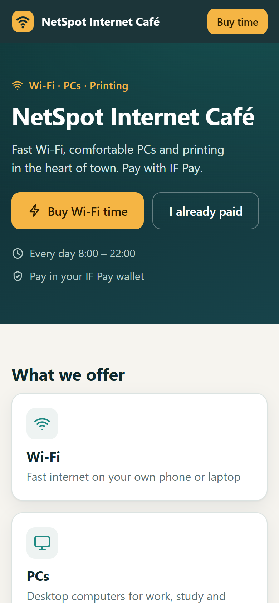
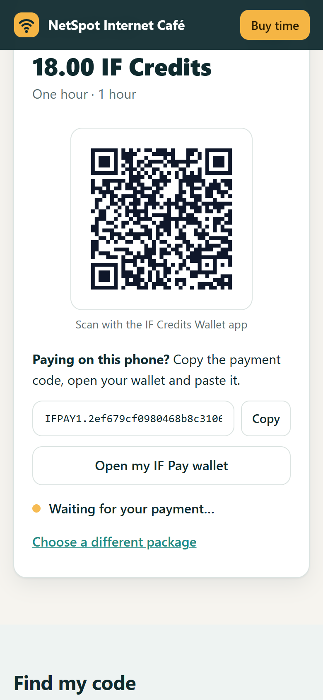
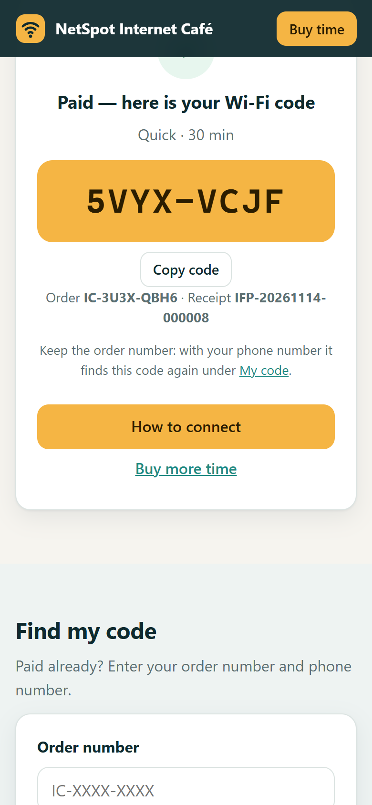

# Internet café website (IntraForge hosted app, IF Pay)

A complete website for an internet café: home, services, Wi-Fi prices, **buy Wi-Fi time with IF Pay**, find a paid
code again, how to connect, and contact details. It runs on IntraForge's **Websites** page as a Node.js app, keeps its
data in an IntraForge database, and takes payments through the café's IntraForge Pay.

**How Wi-Fi access works (option A).** IntraForge does not switch anyone's internet on or off — the café's router does.
You create voucher codes in your **router's own hotspot settings**, import them into IntraForge, and the website sells
them: the customer pays with IF Pay and immediately sees the next unused code, which they type on the router's Wi-Fi
login page. A code is reserved before the customer pays and shown only after IF Pay confirms the payment, so nobody
pays for a code that is not there and no code is ever sold twice.



## For the café owner: set it up (about 30 minutes, once)

### 1. Make the voucher codes in your router

In your router's hotspot / captive-portal settings (MikroTik *Hotspot > Users* or *User Manager*, TP-Link Omada
*Hotspot > Voucher*, UniFi *Hotspot Manager > Vouchers*, OpenWrt / pfSense / OPNsense *Captive portal > Vouchers*), make
a batch of codes for each package you sell — for example 50 codes of 30 minutes, 50 of 1 hour, 20 of 3 hours. Put them
in a spreadsheet with these four columns and save it as CSV (see `vouchers-example.csv`):

| code | minutes | status | order_number |
|---|---|---|---|
| K7MQ-X2VD | 60 | available | *(empty)* |

`minutes` must match a package exactly (60 for one hour).

**Also in the router — the "walled garden" (allowed before login).** Customers buy *before* they are online, so allow
the IntraForge PC's address without login: its IP address (for example `192.168.8.63`) on ports **8445** (the website)
and **8443** (the IF Pay wallet), or the shop names (`myshop.lan`) if you use them. Put a link on the router's login
page: "No code? Buy one: https://192.168.8.63:8445/netspot/".

### 2. Create the café's database in IntraForge

Organization > **Databases** > a project > **New database** named `Internet Cafe`, then these four tables with exactly
these column names and types (**unique** = tick "unique"):

| Table | Columns |
|---|---|
| `cafe_settings` | `key` varchar(100) **unique**, `value` text |
| `cafe_packages` | `name` varchar(100), `minutes` integer, `price` decimal(10,2), `active` boolean |
| `cafe_vouchers` | `code` varchar(64) **unique**, `minutes` integer, `status` varchar(20), `order_number` varchar(20) |
| `cafe_orders` | `number` varchar(20) **unique**, `phone` varchar(20), `package_name` varchar(100), `minutes` integer, `amount` decimal(10,2), `status` varchar(20), `pay_request` varchar(64), `receipt` varchar(64), `voucher` varchar(64) **unique**, `created_at` datetime |

The **unique** ticks on `cafe_vouchers.code` and `cafe_orders.voucher` make the database itself refuse to sell one code
twice — do not skip them. If anything is missing, the website lists exactly what (step 5).

### 3. Fill in the café's details, prices and codes

- **`cafe_packages`** — one row per package: `Quick, 30, 10.00, true`; `One hour, 60, 18.00, true`; … Set `active` to
  false to stop selling one.
- **`cafe_vouchers`** — open the table > **Import CSV** > your file from step 1; map the four columns.
- **`cafe_settings`** — one row per detail you want to show (all optional; the site has sensible defaults):

| key | example value |
|---|---|
| `cafe_name` | NetSpot Internet Café |
| `tagline` | Fast Wi-Fi, comfortable PCs and printing in the heart of town. |
| `about` | A few sentences about the café |
| `address` | Main Street, next to the bus station |
| `hours` | Every day 8:00 – 22:00 |
| `phone`, `whatsapp` | +251 911 000 000 |
| `wifi_name` | NetSpot-WiFi (the Wi-Fi name customers choose) |
| `services` | one per line, `Title / description` separated by a bar: `Wi-Fi \| Fast internet on your phone` |
| `currency` | IF Credits |
| `wallet_url` | the IF Pay wallet address — only if it is not `https://<this PC>:8443/apps/pay-1/wallet` |

Changes show on the website within a minute; no new zip is needed.

### 4. Upload the website

Organization > **Websites** > **New website**: name `NetSpot Internet Café`, address `netspot`, file
`internet-cafe-site.zip`. IntraForge starts it and creates its **application** (its identity in IntraForge).

### 5. Give the website its access

Organization > **Developer** > **Applications** > the website's application (it has the website's name):

1. **IntraForge Pay** box > **Allow IntraForge Pay** (lets the website ask your Pay for payments).
2. **Resource permissions** > **Grant permission**, twice — once with `database.read`, once with `database.write`:
   - Permission code: `database.read` (then `database.write`)
   - Resource type: `databases.tenant_database`
   - Resource ID: the `Internet Cafe` database's ID — open the database; it is the long code at the end of the address
     (`…/tenant-databases/<ID>`).

Give it nothing else. Then open `https://<this PC>:8445/netspot/`. If a yellow "still being set up" box appears, it lists
what is missing.

### Every day

- **Orders:** the `cafe_orders` table shows every sale: `paid` (with its receipt and code), `pending` (waiting for the
  customer), `expired` / `cancelled` (nothing charged; the code went back on sale), `failed` (IF Pay was not reachable).
- **Running low:** a package with no codes left shows **Sold out** by itself and cannot be bought. Import more codes.
- **"I paid but have no code":** ask for the order number and phone and use **My code** on the website, or find the order
  in `cafe_orders` (its `voucher` column). The IF Pay receipt number matches `receipt`.
- **Refunds** are done in IF Pay (Refunds); set the code back to `available` only if the customer never used it.





## What the customer does

1. Joins the café Wi-Fi; the login page opens. No code yet: follows the link to the website (or scans a poster QR).
2. Chooses a package, enters a phone number, presses **Pay with IF Pay**.
3. **Another phone or the counter screen:** scans the QR code with the IF Credits Wallet app. **The same phone:** presses
   **Copy**, then **Open my IF Pay wallet**, pastes the code under *Scan QR > …or paste the payment code*, and confirms.
4. Comes back to the website: the code is already there. Types it on the Wi-Fi login page.
5. Lost the page? **My code**: order number + phone number shows the code again.

The QR code is valid for about two minutes (IF Pay's rule); if it runs out nothing is charged and the customer starts
again. The page remembers an unfinished payment, so switching to the wallet and back, or refreshing, is safe.

## Limits (honest)

- It sells codes your router made; it does not count minutes or disconnect anyone — the router does. A live countdown,
  a per-device free trial and remote disconnect need the full Wi-Fi café system (the router asks IntraForge directly,
  RADIUS), which is separate work.
- No free first 30 minutes: on this design it could only be checked by phone number, which is not verified.
- Buying from home (off the café Wi-Fi) works only if the Super Administrator publishes the site through Internet
  access; by default it is reachable on the café network only.
- In the pilot, IF Credits are simulated (no cash value).

## For developers

| Path | What it is |
|---|---|
| `intraforge.json` | `{"runtime": "node", "entry": "server.js"}` — tells IntraForge the zip is a Node.js app |
| `server.js` | HTTP server: the page files and the JSON API (`api/info`, `api/orders`, `api/orders/<n>`, `api/lookup`, `api/setup`); strict security headers, body limit, per-address rate limits |
| `lib/intraforge.js` | The only door to IntraForge: `IF_API_URL` + `IF_API_TOKEN` (the token never leaves the server) |
| `lib/store.js` | Finds the café database by its four tables; checks columns, types and unique rules; reads settings and packages |
| `lib/orders.js` | Reserve → pay → settle; expiry; the sweep that returns abandoned reservations; every step safe to repeat |
| `lib/limits.js` | Per-address rate limiting |
| `public/` | `index.html`, `styles.css`, `app.js`: one phone-first page, no outside fonts or scripts |
| `test/` | `node --test` suites against an in-memory IntraForge that enforces the real API's rules (unique columns, datetime format) |
| `tools/make_zip.py` | Builds `dist/internet-cafe-site.zip` (code only; tests and tools stay out) |

```
npm test                     # 20 tests: reserving, paying, expiry, sold out, concurrent buyers, the sweep, HTTP security
python tools/make_zip.py     # dist/internet-cafe-site.zip
```

No npm packages: Node's own `http`, `crypto`, `fetch` and `node:test`. IntraForge runs it as `node server.js` in its
locked app container (read-only, no internet, only `IF_API_URL`, `IF_API_TOKEN`, `IF_SITE_NAME` and `PORT`).

**Rules kept:** the browser never names a price or an amount; IF Pay's answer alone decides "paid"; a code is revealed
only for a paid order (by its unguessable order number, or order number + phone); one code per order is enforced by the
database's unique column, not by trust; logs and answers never contain the token, a phone number or a code.

**Tested** on the IntraForge 1.5 test copy (2026-11-14): a real purchase paid with the test customer's IF Pay wallet
(order paid, code shown and found again, voucher marked sold); an unpaid QR expiring with its code returned to sale; a
refresh in the middle of paying; phone and desktop layouts; security headers and file protections. Not yet tested: a
real router's voucher login, and a phone on a real café Wi-Fi.
